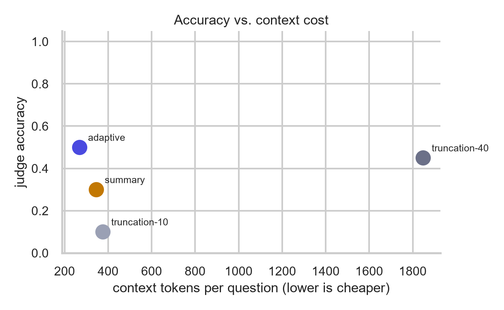

# Adaptive Memory for AI Chatbots

An adaptive memory system for long conversations with AI chatbots. Instead of truncating old
messages or squashing everything into one summary, it **categorizes** what the user says (facts,
preferences, goals, decisions, completed tasks), **scores** each item by likely future usefulness,
**detects contradictions** with older memories (and replaces outdated ones), and **retrieves** only
what is relevant to the current question. A Chrome extension captures ChatGPT messages and can put the
stored memory back into a new chat, so the memory moves between conversations.

EDA course project. Team: Peehu Gupta, Tvisha Thakur, Vrishti Sharma.

## Results

Evaluated on the LoCoMo benchmark (conversation conv-26, first 100 turns, 20 questions) against two
baselines: keeping only the last N turns (truncation) and a single running summary. Every method is
scored on the same questions. Full numbers, charts and limitations: [`docs/results_for_slides.md`](docs/results_for_slides.md).

| Method | Judge accuracy | Token F1 | Context tokens (avg) |
|---|---|---|---|
| **Adaptive memory (top-5)** | **0.50** | **0.459** | **268** |
| Truncation (last 40 turns) | 0.45 | 0.421 | 1,848 |
| Single summary | 0.30 | 0.178 | 345 |
| Truncation (last 10 turns) | 0.10 | 0.067 | 375 |

- Adaptive memory matches the 40-turn baseline's accuracy with about **7x less context**.
- Contradiction handling, on 60 hand-written memory pairs: **0 wrong replacements**, 23 of 25 updates caught
  (the 2 misses were filtered out by the similarity gate).
- Caveats: one conversation and 20 questions, so the accuracy differences between adaptive and
  truncation-40 are within noise; the same model answers and judges. Weak spots: temporal and
  multi-hop questions.



## Architecture

```
Chrome extension (JS)  --HTTP-->  FastAPI server (Python)  -->  Memory engine
  captures your messages           /add_message                  categorize
  popup: view / retrieve /         /retrieve                     score
  insert memory into the chat      /export                       detect contradictions
                                   DELETE /conversation/{id}     store (SQLite)
                                   /health                       retrieve (local embeddings)
```

- **`memory_engine/`**: the core logic: categorization, importance scoring, contradiction detection,
  storage, and retrieval. Embeddings are computed **locally** (MiniLM via `fastembed`, no API key needed).
  Categorization and contradiction judging call an LLM on Groq.
- **`server.py`**: FastAPI server exposing the engine to the extension.
- **`extension/`**: Chrome extension (Manifest V3): background worker, content script (ChatGPT only),
  popup panel.
- **`evaluation/`**: LoCoMo evaluation harness, result summaries/charts, retrieval and contradiction experiments.
- **`docs/`**: frozen result charts and CSVs (`docs/figures/`), results note, scoring notes.
- **`tests/`**: unit tests (no network or API key needed).

How a message is handled: categorize it, skip small talk, score its importance, compare it against similar
stored memories (cosine similarity gate, then an LLM judge: add, replace, or skip as duplicate), then store it.
Retrieval ranks memories by `0.7 * similarity + 0.3 * importance`.

## Setup

### 1. Prerequisites
- Python 3.10+ (3.11 or 3.12 recommended)
- Google Chrome
- A free [Groq API key](https://console.groq.com/keys)

### 2. Install

```bash
git clone https://github.com/tvxsha/adaptive-memory-chatbot.git
cd adaptive-memory-chatbot
python -m venv venv
venv\Scripts\activate          # macOS/Linux: source venv/bin/activate
pip install -r requirements.txt
```

The first run downloads the small embedding model (about 90 MB). On Windows you may see a symlink warning
(`WinError 1314`); it is harmless and the download still completes.

### 3. Configure

```bash
copy .env.example .env         # macOS/Linux: cp .env.example .env
```

Open `.env` and set `GROQ_API_KEY`. Nothing else is required.

### 4. Run the server

```bash
uvicorn server:app --port 8000
```

Open http://localhost:8000/docs to try the API without the extension.

### 5. Load the Chrome extension

1. Go to `chrome://extensions` and turn on **Developer mode**.
2. Click **Load unpacked** and select the `extension/` folder (the one containing `manifest.json`).
3. Pin the **Adaptive Memory** icon. After any code change, click the reload arrow on its card **and refresh the ChatGPT tab**.

### 6. Try it

1. With the server running, open https://chatgpt.com and send a few messages about yourself
   (for example, "I'm allergic to peanuts and I prefer vegetarian food."). Watch the server log: each message is
   categorized, scored, and stored.
2. Click the extension icon to see the stored memories, or use **Retrieve** to ask what is relevant to a question.
3. Open a new chat. In the popup, set the **Conversation** box to the old chat's URL and click
   **Insert into chat box**. The memory summary appears in the input box; add your question and send.
   If the insert cannot reach the page, the popup copies the summary to the clipboard instead.

For a clean demo, turn off ChatGPT's own Memory (Settings, then Personalization), so that any personalisation
clearly comes from this extension. Only ChatGPT is supported; the Claude and Gemini selectors are placeholders.

### 7. Quick API test (no extension)

```bash
curl -X POST http://localhost:8000/add_message -H "Content-Type: application/json" ^
  -d "{\"conversation_id\": \"test1\", \"role\": \"user\", \"text\": \"My favorite color is blue\"}"

curl "http://localhost:8000/retrieve?conversation_id=test1&query=what color do I like"
```

(On macOS/Linux use `\` for line breaks and single quotes around the JSON.)

## Tests

```bash
pytest tests/
```

## Reproducing the evaluation

The evaluation runs on the LoCoMo data in `data/locomo10.json` and uses the Groq free tier
(about 200,000 tokens per day per organization). Runs save their progress and can be resumed after a rate limit.

```bash
# Main comparison: adaptive memory vs. truncation (10 and 40 turns) vs. summary
python evaluation/run_eval.py --convs conv-26 --max-turns 100 --max-questions 20

# Charts and tables from the saved results (no model calls); output goes to docs/figures
python evaluation/summarize_results.py --out docs/figures

# Retrieval analysis (no model calls, uses the stored memories from the run above)
python evaluation/retrieval_analysis.py

# Contradiction test: free gate statistics, then add --judge to run the real LLM judge
python evaluation/contradiction_eval.py
python evaluation/contradiction_eval.py --judge
```

Use `--dry-run` on `run_eval.py` to test the flow without any API calls. To also keep small-talk turns
(an ablation), set `STORE_RECENT_CHAT=1` for that run only. Keep it unset when running the server for the demo.

## Limitations and future work

- Evaluated on one conversation and 20 questions; a larger run (more conversations) would give tighter estimates.
- The same model answers and judges, which can bias the accuracy score. Token F1 is reported alongside it.
- Weak on temporal questions (memories carry no timeline) and multi-hop questions (several memories needed at once).
- The extension supports ChatGPT only, and ChatGPT changes its page markup from time to time.
- Contradiction test pairs were written by the authors; independent labelling is in progress.